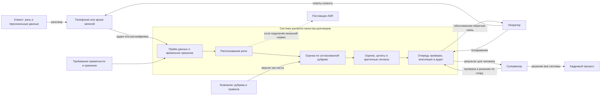

# PRD: контроль качества разговоров

**Статус:** черновик для обсуждения с командой и проверки интервью. Сегмент и целевые значения ниже являются гипотезами, а не результатами исследования.

## Сегмент

Супервизоры небольших и средних команд входящей поддержки, которые еженедельно оценивают разговоры операторов по чек-листу компании и сейчас делают это вручную по записям.

Внутри сегмента приоритетны команды, где звонков слишком много для полной ручной проверки, а ошибки в консультации влияют на клиента или создают регуляторный риск. Размер команды, отрасль и используемая телефония пока не подтверждены; это вопросы для интервью.

## Проблема и обстоятельства

1. В течение смены супервизор не может прослушать все разговоры и выбирает небольшую случайную выборку. Большая часть звонков остаётся без оценки, а редкое нарушение может не попасть в выборку.
2. При разборе спорной оценки оператору трудно понять, на какой реплике она основана. Супервизору приходится повторно искать нужный фрагмент в записи.
3. Одни пункты чек-листа формальны, другие зависят от контекста. Разные проверяющие могут по-разному оценить один и тот же разговор.
4. Критичные нарушения, например обещание неподтверждённого срока или разглашение чужих данных, требуют отдельного внимания и понятного порядка эскалации.
5. Запись и расшифровка могут содержать персональные данные, поэтому нельзя без отдельного основания сохранять их в рабочем наборе продукта.

Эти боли следуют из описания темы курса и ещё не проверены с представителями выбранного сегмента.

## Предлагаемый результат

Система принимает запись или расшифровку разговора, применяет согласованный чек-лист и возвращает оценку по каждому критерию вместе с подтверждающей цитатой. Критичные нарушения выделяются отдельно и передаются супервизору на проверку. Супервизор может принять оценку, исправить её или отправить на разбор; автоматическая оценка сама по себе не является кадровым решением.

Распознавание речи, оценка по рубрике и хранение данных рассматриваются как отдельные этапы. До проверки качества система должна показывать, если расшифровка недостаточна для надёжной оценки, и не выдавать уверенный вывод без подтверждения.

## Контекст и граница системы

### Что относится к системе

- Приём записи или расшифровки, временное хранение и удаление по согласованным правилам.
- Распознавание речи как функция продукта, оценка по версии рубрики, поиск подтверждающих цитат и выделение критичных сигналов.
- Передача результата супервизору, фиксация его решения и обработка оспаривания оператором.

### Что находится снаружи, но влияет

- Клиент, оператор и телефония создают разговор и исходную запись; система не управляет тем, что было сказано.
- Компания задаёт чек-лист и политику критичных нарушений; супервизор применяет их и принимает решение по спорному результату.
- Требования приватности и хранения ограничивают обработку данных.
- Поставщик ASR, если он используется, остаётся внешней технической зависимостью. Само распознавание входит в продуктовую ответственность: ошибка расшифровки влияет на итоговую оценку.

### Что вне границы и не является целью

Кадровые решения, управление сменами и расчёт зарплаты выполняются людьми и существующими процессами, а не системой контроля качества. Супервизор может использовать результат проверки как один из источников, но решение принимает сам. Интеграции с кадровыми системами не нужны для проверки разговора и в первую версию не входят.

**Спорный элемент — распознавание речи.** Его можно считать отдельным внешним сервисом, если использовать API поставщика, но функцию распознавания оставляем внутри системной границы. Иначе продукт не отвечает за качество пути от аудиозаписи до оценки и не сможет измерять ошибки, вызванные расшифровкой. Внешними остаются поставщик и его инфраструктура; передачу ему аудио нужно отдельно разрешить с точки зрения приватности.

## Заинтересованные стороны и расхождение целей

| Сторона | Цель относительно системы | Возможное расхождение |
| --- | --- | --- |
| Супервизор | Проверить больше разговоров за то же время, быстро найти основания оценки и оставить за собой решение по спорным случаям. | Скорость и широкое покрытие могут конфликтовать с тщательной ручной проверкой контекста и ложных сигналов. |
| Оператор | Получить справедливую, понятную и оспоримую оценку; не быть наказанным за ошибку распознавания или неверную интерпретацию. | Автоматическое снижение оценки ради охвата конфликтует с правом на объяснение и пересмотр человеком. |
| Руководитель поддержки | Снизить пропуски нарушений и видеть сопоставимое качество работы смены. | Желание использовать оценки для кадровых решений может конфликтовать с ограничением системы не принимать такие решения автоматически. |
| Клиент и владелец персональных данных | Получить корректное обслуживание и не допустить раскрытия или избыточного хранения своих данных. | Полные записи помогают проверке, но увеличивают объём чувствительных данных и риск доступа к ним. |
| Ответственный за приватность / безопасность | Минимизировать данные, ограничить доступ и соблюдать сроки хранения. | Минимизация и короткое хранение могут затруднить повторный разбор и аудит. |
| Quality & Safety | Измерять точность и полноту, особенно по критичным нарушениям, и выявлять систематические ошибки. | Высокая полнота критичных сигналов может увеличить число ложных тревог и нагрузку супервизора. |

**Принцип разрешения конфликтов:** приватность и право человека на пересмотр важнее максимального охвата; система показывает доказательства и неопределённость, а не принимает кадровое решение. Баланс полноты сигналов и ложных тревог, как и сроки хранения, нужно согласовать с супервизорами и ответственными сторонами до пилота.

## North Star и ограничения

**North Star:** доля проверенных разговоров, по которым супервизор подтверждает оценку, а оператору понятна причина каждого снижения балла.

**Предлагаемая цель пилота:** не менее 80% разговоров из согласованной пилотной выборки получают подтверждение супервизора и не требуют повторного поиска доказательства в записи. Способ измерения: число таких разговоров / число разговоров, отправленных на проверку; спорные и непригодные для оценки случаи учитываются отдельно. Порог 80% предварительный и должен быть согласован с Quality & Safety после определения выборки и базового процесса.

Предлагаемые эксплуатационные ограничения, требующие проверки AI Engineer:

- **Задержка:** результат для одного разговора длительностью до 10 минут не позднее 5 минут после получения записи или расшифровки.
- **Цена:** не более 20 рублей за один разговор длительностью до 10 минут, включая распознавание речи и оценку. Это стартовый бюджетный предел, а не рассчитанная стоимость.

## Возможности команды и границы

- Product / VO уточняет сегмент, критерии рубрики и процесс оспаривания.
- AI Engineer сравнивает распознавание речи и способы оценки, проверяет цитаты и считает задержку и стоимость.
- Quality & Safety определяет измеримые критерии, критичные ошибки и план эталонных примеров.
- Delivery обеспечивает воспроизводимый запуск и безопасный контур обработки данных.

В первой версии не принимаются кадровые решения автоматически, не обещается полная замена супервизора и не используются реальные записи без разрешённого основания и согласованного режима обработки.

## Открытые вопросы

- Какой тип поддержки и какой чек-лист выбрать для первого сценария?
- Кто и как часто проверяет оценки, и сколько времени уходит на одну проверку?
- Какие критерии требуют контекста и как команда фиксирует решение по спорным случаям?
- Как определяется критичное нарушение и кому оно эскалируется?
- Какие данные разрешено обрабатывать, как их обезличить и когда удалять?
- Согласны ли супервизоры с предложенными целями задержки, цены и качества?